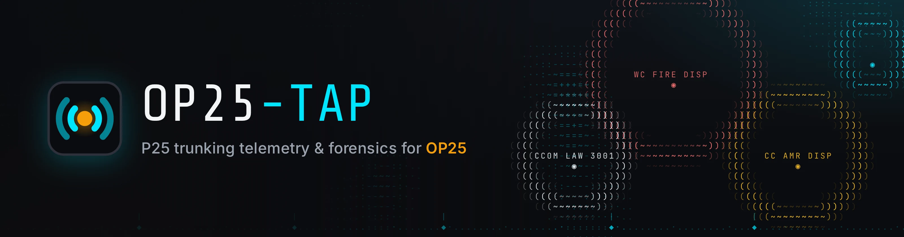
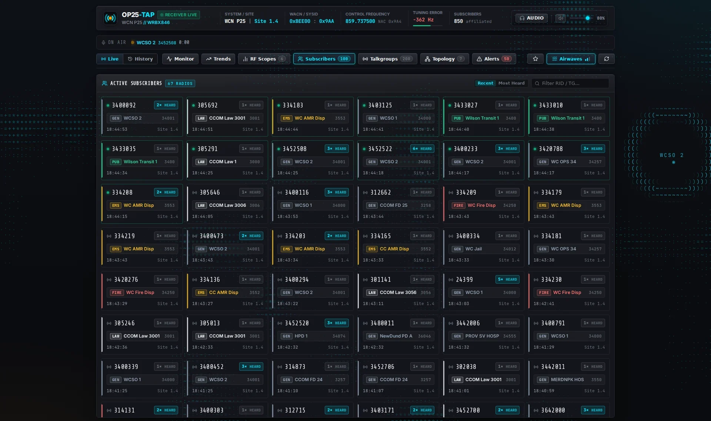

<p align="center">
  
</p>

<p align="center">
  <b>A P25 trunking dashboard in the browser.</b><br>
  Live calls, subscribers and forensics for <a href="https://github.com/boatbod/op25">OP25</a>, with an ASCII airwaves backdrop that shows what your receiver is hearing.
</p>

<p align="center">
  
  
  
  
  
</p>

<p align="center">
  
</p>

## What it does

- **Steady live monitor.** Every monitored frequency keeps a fixed tile in frequency order, and an on-air bar lists each active call with a running timer on every tab. Calls starting and stopping change colours and text, never the layout.
- **Airwaves backdrop.** An ASCII field behind the glass panels mirrors the receiver. Static crackles harder as tuning error grows, a carrier ticks on every control-channel hit, and a ring labelled with the talkgroup appears when a channel keys up (colour by category; encrypted calls scramble). Off, Subtle, Normal or Lively, and it dims when the system goes quiet.
- **Call forensics.** A real-time call stream (talkgroup, source radio, frequency, duration, `CLEAR` / `ENC`), subscriber affiliations, a talkgroup directory with airtime, an adjacent-site topology map, and alerts for new radios, talkgroups, sites and activity spikes.
- **Focus on what matters.** Click any talkgroup or radio ID for its stats, 24-hour activity, affiliations and recent calls. Pin talkgroups and **Follow** them to narrow every panel. Lists freeze under your mouse, and keyboard shortcuts cover tabs, search and audio (press `?`).
- **History and trends.** Switch from Live to any past range (bookmarkable URL), drill into an activity timeline, and read 7/30/90-day trends built from daily rollups that outlive the raw data.
- **Voice intercepts.** Live browser audio from OP25's PCM port, recorded call audio for playback, and optional Whisper transcription with search.
- **Honest status.** An offline or reconnecting banner replaces stale "live" data, and storage stays bounded by a retention policy.
- **One container, nothing external.** FastAPI serves the API, the WebSocket stream and the compiled UI on a single port. Fonts are self-hosted, so the page makes no CDN requests.
- **A light touch on OP25.** It asks OP25's HTTP endpoint for status and reads its audio port. The only control command it ever sends is the one that toggles the RF scope plots.

```
OP25 ─ HTTP status :8080 ─▶ poller ─▶ diff + anomaly engine ─▶ SQLite ─┐
     └ raw PCM audio :9000 ─▶ recorder ─▶ Whisper (optional) ──────────┤
                                                       FastAPI ─ REST + WebSocket ─▶ browser
```

## Screenshots

| Detail drawer | Trends |
| --- | --- |
|  |  |

| Network topology | RF scopes |
| --- | --- |
|  |  |

| Alerts and forensics | Phone |
| --- | --- |
|  |  |

On a wide screen the Subscribers tab fills the window, and the radio pings show in the margins:



## Requirements

**A working OP25 by [boatbod](https://github.com/boatbod/op25).** It must be installed, configured for your SDR (RTL-SDR, HackRF, Airspy, ...) and actively decoding your trunked system.

- **HTTP server (required).** Launch OP25 with its status endpoint enabled, for example `-l http:0.0.0.0:8080` in `rx.py` or `multi_rx.py`. This is the feed op25-tap polls.
- **Live audio and transcription (optional).** Enable OP25's raw audio forwarding (for example `-V` flags sending 8 kHz mono PCM to port `9000`) for browser audio and Whisper speech-to-text.

## Quick start

```sh
git clone https://github.com/d3mocide/op25-tap && cd op25-tap
cp .env.example .env          # set OP25_URL to your OP25 HTTP endpoint
docker compose up -d          # pulls ghcr.io/d3mocide/op25-tap, UI on http://localhost:8000
```

Pin a release with `OP25TAP_TAG=0.1.0` in `.env`, and update with `docker compose pull && docker compose up -d`. To build from source instead, use `docker compose -f docker-compose.build.yml up -d --build`. `make help` lists these shortcuts.

That is enough for live monitoring. Add `WHISPER_URL` for transcripts, and see [Configuration](#configuration) for retention, time zone and multi-receiver setups. It runs on a 64-bit Raspberry Pi (arm64), which is where it is developed.

Put a reverse proxy in front for TLS and authentication if you expose it beyond your LAN.

## Docs

[UI guide](web/docs/UI.md) · [Configuration](#configuration) · [Advanced config](config/README.md) · [Design notes](DESIGN.md)

## Configuration

<details>
<summary><b>Environment variables (<code>.env</code>)</b></summary>

For almost all setups, configuration is handled via environment variables or a `.env` file in the project root. Copy `.env.example` to get started:

```bash
cp .env.example .env
```

| Variable             | Default               | Description                                                 |
| :------------------- | :-------------------- | :---------------------------------------------------------- |
| `OP25_URL`           | `http://<op25-host>:8080/` | Target OP25 receiver HTTP endpoint                          |
| `OP25_AUDIO_WS`      | _(auto-derived)_           | Optional raw PCM WebSocket URL (e.g. `ws://<op25-host>:9000`) |
| `OP25_POLL_INTERVAL` | `1.0`                 | Polling frequency in seconds                                |
| `OP25_HOLD_SECONDS`  | `3.0`                 | Hang time before an inactive call is considered closed      |
| `OP25_SYSTEM_NAME`   | `County P25`          | Default human-readable label if OP25 reports no system name |
| `HOST`               | `0.0.0.0`             | API server host binding                                     |
| `PORT`               | `8000`                | Port for the API + web UI (production serves both on this one port) |
| `FRONTEND_PORT`      | `5173`                | Dev only: Vite hot-reload UI port (`docker-compose.dev.yml`, `npm run dev`) |
| `OP25TAP_DATA_DIR`   | `./data`              | Directory for persistent SQLite databases and cache         |
| `WHISPER_URL`        | _(disabled)_          | Remote OpenAI-compatible Whisper transcription URL          |
| `WHISPER_MODEL`      | `base.en`             | Whisper model name passed to remote API                     |
| `WHISPER_API_KEY`    | _(optional)_          | Bearer token or authorization key for Whisper service       |
| `WHISPER_LANGUAGE`   | `en`                  | Spoken language hint for transcription                      |
| `RETENTION_DAYS`     | `30`                  | Days of raw history (calls, affiliations, roaming, alerts) to keep; `0` keeps everything |
| `AUDIO_RETENTION_HOURS` | `168`              | Hours to keep recorded call audio for playback; `0` disables saving audio (was `WHISPER_RETENTION_HOURS`, still honored) |
| `MAINTENANCE_INTERVAL_MINUTES` | `15`        | How often rollups, purging and audio cleanup run            |
| `TZ`                 | _(system)_            | Time zone that defines "a day" for daily trends (e.g. `America/Chicago`; set it in Docker, which defaults to UTC) |

</details>

<details>
<summary><b>Advanced configuration (<code>config/</code>)</b></summary>

If you require advanced capabilities such as polling multiple OP25 instances simultaneously, granular hex NAC lookup tables, or custom regex naming rules, you can optionally supply JSON files in the `config/` folder:

- **`config/op25.json`**: Multi-endpoint arrays (`endpoints: [...]`) and NAC/SYSID mapping tables (`systems: { "0x3cc": "County P25" }`). See [config/op25.example.json](config/op25.example.json).
- **`config/systems.json`**: Regex/prefix system name canonicalization rules and RadioReference System ID deep-links (`rr_sids`). See [config/systems.example.json](config/systems.example.json).

_For in-depth schema documentation on JSON configuration, see [config/README.md](config/README.md)._

</details>

<details>
<summary><b>Data retention and history</b></summary>

A background maintenance job (every `MAINTENANCE_INTERVAL_MINUTES`) keeps storage bounded:

| Data | Kept for | Notes |
| :--- | :------- | :---- |
| Calls, affiliations, roaming, alerts | `RETENTION_DAYS` (30) | Cut at local midnight, so a day is either fully kept or fully purged |
| Call audio (WAV) | `AUDIO_RETENTION_HOURS` (168) | About 1 MB per minute of audio, which is usually the biggest consumer of disk space |
| Daily rollups (per system, talkgroup, radio) | Forever | Very small; powers the Trends dashboard beyond the raw retention window |
| Talkgroup / radio / site directories | Forever | Names, first/last seen, lifetime counters |

Every day is rolled up before it's purged. Freed space is returned to the OS (SQLite incremental vacuum). `GET /api/storage` reports DB and audio size, row counts and the oldest retained record.

Schema changes are applied automatically on startup through numbered migrations (`PRAGMA user_version`). The first start after upgrading drops the unused trunk-tap tables and runs a one-time `VACUUM`, which can take a moment on a large database.

</details>

## Develop

Requires Docker, or Python 3.12 with [`uv`](https://docs.astral.sh/uv/) and Node 22 for a local setup.

```sh
# Backend and frontend in Docker with hot reload (UI on :5173)
make dev   # or: docker compose -f docker-compose.dev.yml up --build -d

# Backend tests
uv venv && uv pip install -r requirements.txt pytest httpx2
.venv/bin/pytest tests

# Frontend
cd web && npm install
npm run dev                                       # Vite on :5173, proxies /api and /ws to :8000
npm run build                                     # typecheck and production bundle
BASE_URL=http://localhost:8000 npm run test:e2e   # Playwright smoke tests (first: npx playwright install chromium)
```

The end-to-end tests run against a live instance, because they check real behaviour such as the layout staying put while calls come and go. Point `BASE_URL` at a running op25-tap that is receiving telemetry.

<details>
<summary><b>Project structure</b></summary>

```
op25-tap/
├── api/                  # FastAPI application & WebSocket handlers
├── config/               # Optional endpoint and system-name mappings
├── db/                   # SQLite schema & database helpers
├── ingest/               # OP25 poller, audio recorder, Whisper client, anomaly detection, retention
├── tests/                # Backend tests
├── web/                  # Vite + React / TypeScript frontend
│   ├── src/
│   │   ├── components/   # Header, VoiceGrid, NowTalking, AsciiBackdrop, EntityDrawer, feeds, tabs
│   │   ├── context/      # Pinned talkgroups, follow mode, detail drawer
│   │   ├── hooks/        # Live telemetry (WebSocket), history, time range, list hold
│   │   └── styles/       # Shared and per-feature CSS
│   ├── e2e/              # Playwright smoke tests
│   ├── docs/             # UI guide, screenshots, README banner
│   └── public/           # Icons and web manifest
├── Dockerfile                # Multi-stage build (frontend, then Python runtime)
├── docker-compose.yml        # Pulls the published image
├── docker-compose.build.yml  # Builds the image locally
├── docker-compose.dev.yml    # Hot-reload dev stack
└── Makefile                  # make help
```

</details>

## License

GPL-3.0. See [LICENSE](LICENSE). OP25 runs as a separate process that op25-tap only queries over HTTP and reads audio from. The bundled fonts (Inter, JetBrains Mono, Share Tech Mono) are licensed under the SIL Open Font License 1.1.

## Acknowledgments & Credits

- [**colonelpanichacks/trunk-tap**](https://github.com/colonelpanichacks/trunk-tap) — The pioneer SDRTrunk forensics dashboard whose architecture, anomaly tracking patterns, and UI philosophy directly inspired `op25-tap`.
- [**boatbod/op25**](https://github.com/boatbod/op25) — The foundational open-source OP25 software-defined radio implementation for P25 Phase 1 / Phase 2 digital trunking and HTTP telemetry reporting.
