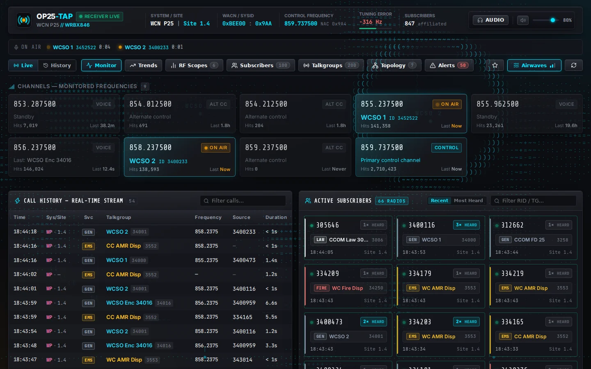
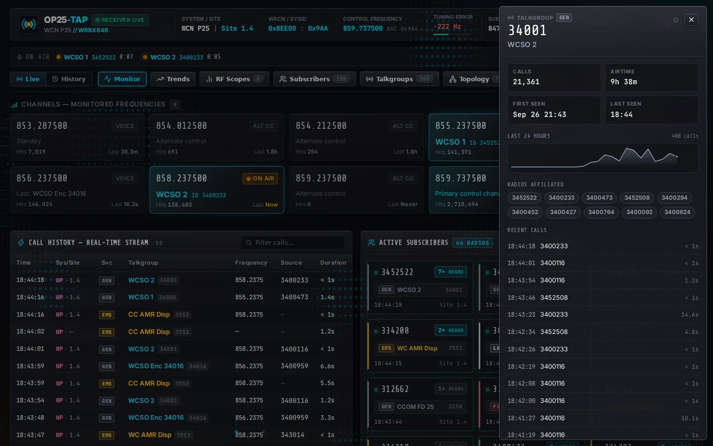
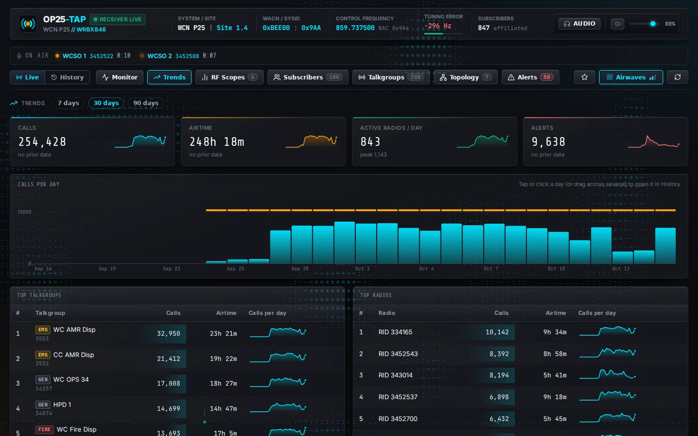
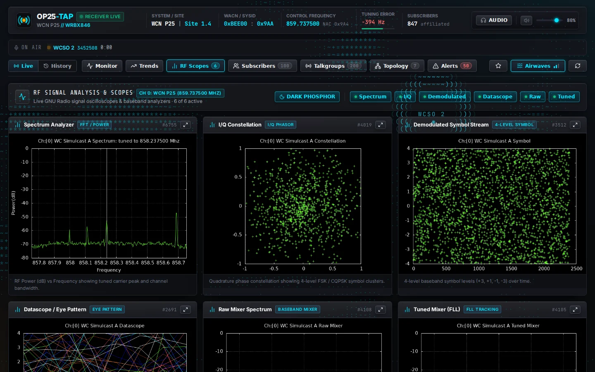
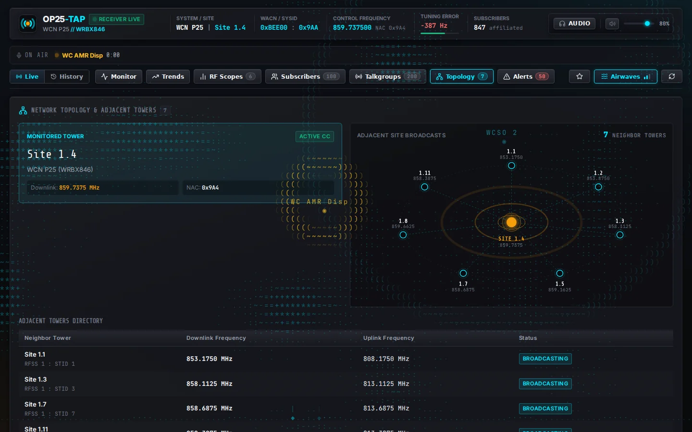
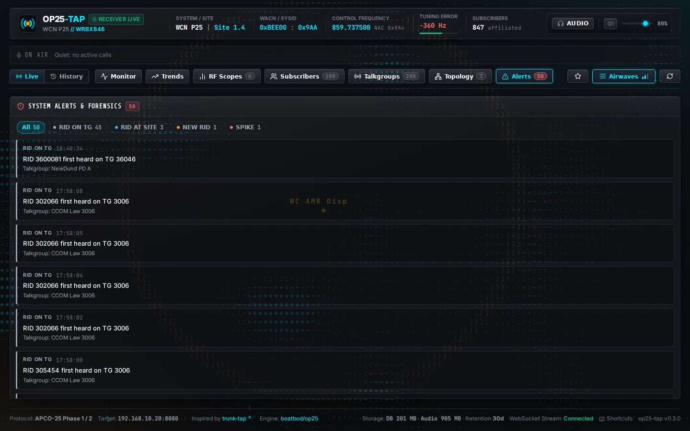
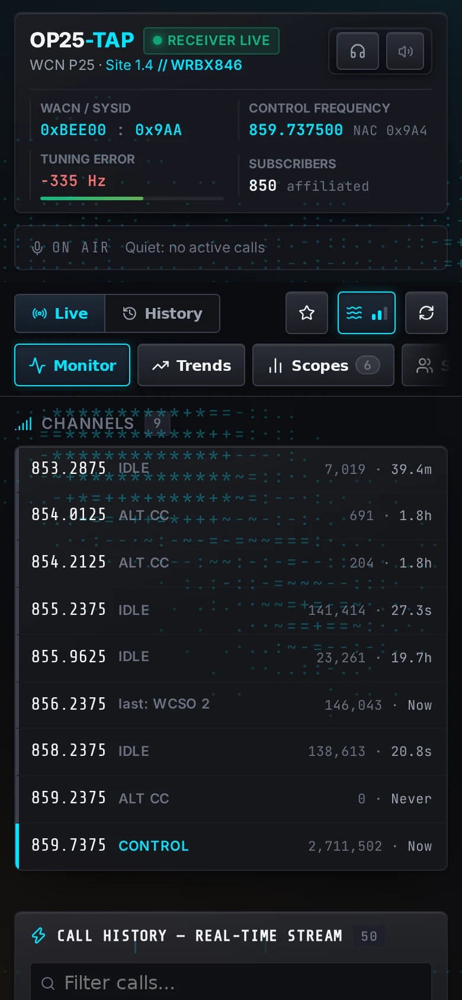

# op25-tap UI guide



## Live monitor

- **On-air bar** (under the header, every tab): each active call with its talkgroup, radio ID and a running timer. It is always present, so the page never shifts when calls start and stop.
- **Channels**: every monitored frequency keeps its own fixed tile, in frequency order. A call changes a tile's colour and text, never its size or position. An idle tile keeps showing the last talkgroup heard.
- **Airwaves backdrop**: an ASCII field behind the glass panels that mirrors the receiver. Static crackles harder as tuning error grows, a carrier along the bottom ticks on every control-channel hit, and a ring with the talkgroup name appears when a channel keys up (colour = category, encrypted calls scramble and lose the label). It dims after five quiet minutes and freezes in History. Click **Airwaves** or press `A` to cycle Off / Subtle / Normal / Lively.

## Talkgroups and radios



- Click any talkgroup or radio ID, anywhere, to open a drawer with its stats, a 24-hour activity line, who it is affiliated with and its recent calls (with transcripts).
- **Pin** a talkgroup with its star (call history, transcripts, directory or drawer). Pinned talkgroups float to the top of the directory.
- **Follow** (`F`) narrows every panel, the channel tiles and the backdrop to the pinned talkgroups.

## Lists that hold still

While the mouse is over Call History or Active Subscribers the visible rows are frozen and the list's count badge turns amber. New arrivals are counted in a "N new" pill that straddles the panel header's bottom edge, so it never pushes rows down or covers them; click it, or move the mouse away, to release them. Rows already on screen still update in place, and a row that stops matching a filter still disappears.

## Alerts

Notable alerts raised while you are watching (spikes, new talkgroup / site / radio) appear as a short toast in the top-right corner; click one to open the Alerts tab. Routine "new radio on a known talkgroup" alerts stay on the tab.

## Keyboard shortcuts

| Key | Action |
| --- | --- |
| `1` – `7` | Switch tabs |
| `L` / `H` | Live / History |
| `/` | Focus the search box |
| `Space` | Audio on / off |
| `F` | Follow pinned talkgroups |
| `A` | Cycle the Airwaves backdrop |
| `Esc` | Close the drawer or help |
| `?` | Show shortcuts |

## Other views

| Trends | RF Scopes |
| --- | --- |
|  |  |

| Topology | Alerts |
| --- | --- |
|  |  |

On a phone the tab strip scrolls sideways and channels collapse to a compact list:



## Preferences

Stored in the browser only (`localStorage`): backdrop mode, pinned talkgroups and follow state.

## Tests

`npm run test:e2e` runs the Playwright smoke tests against a live instance:

```bash
BASE_URL=http://localhost:8000 npm run test:e2e
```

They check that the page loads without errors, every tab renders, nothing scrolls sideways, the layout stays put while calls come and go, the drawer opens and closes, pin and follow narrow the call list, and the list hold works.
